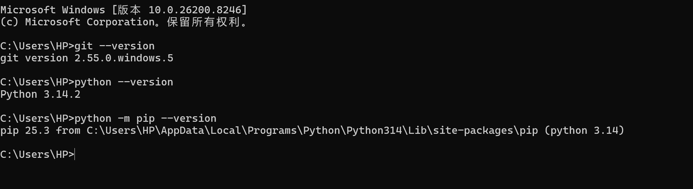
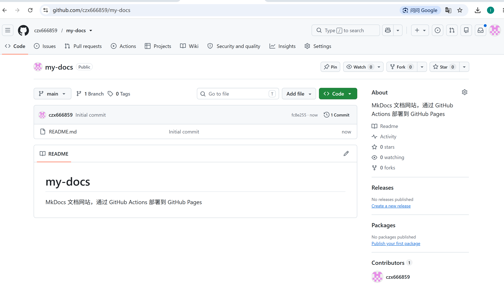
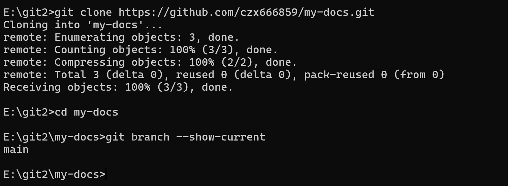
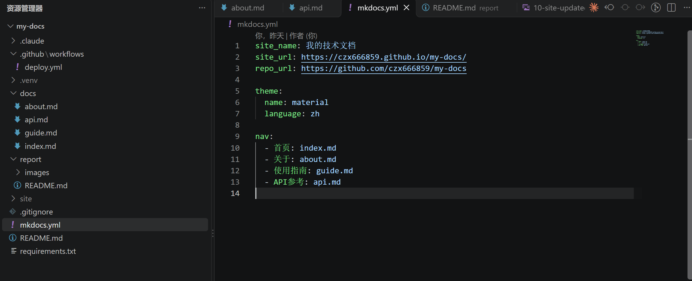
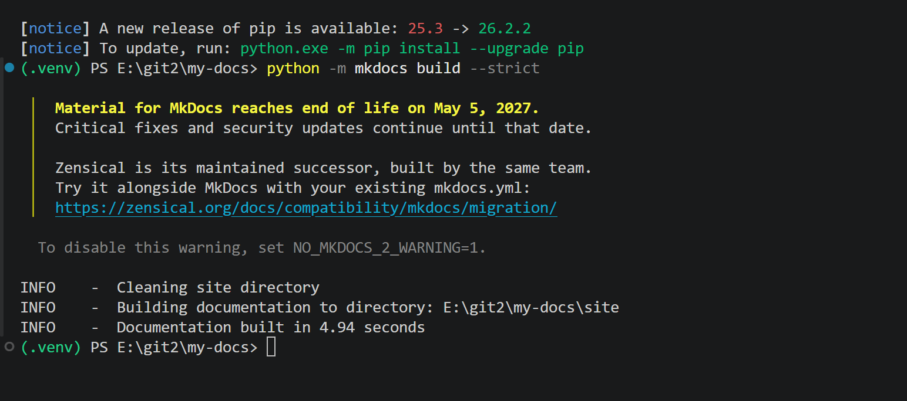
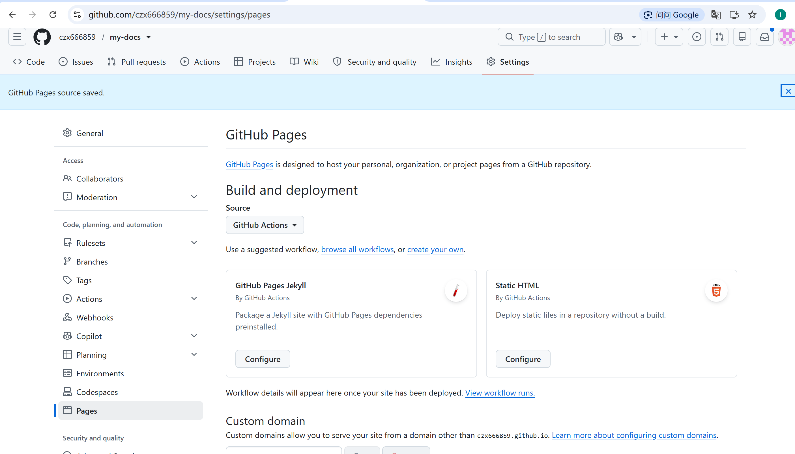
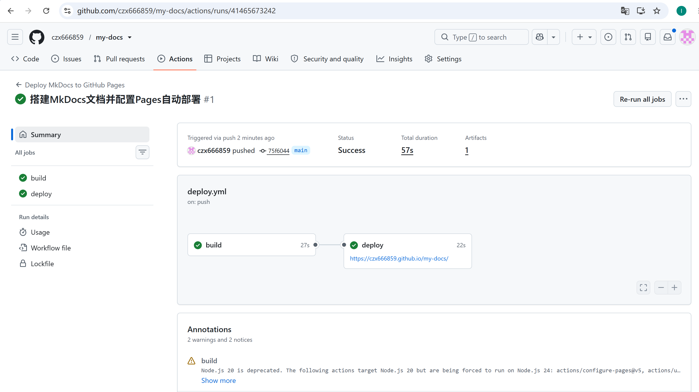
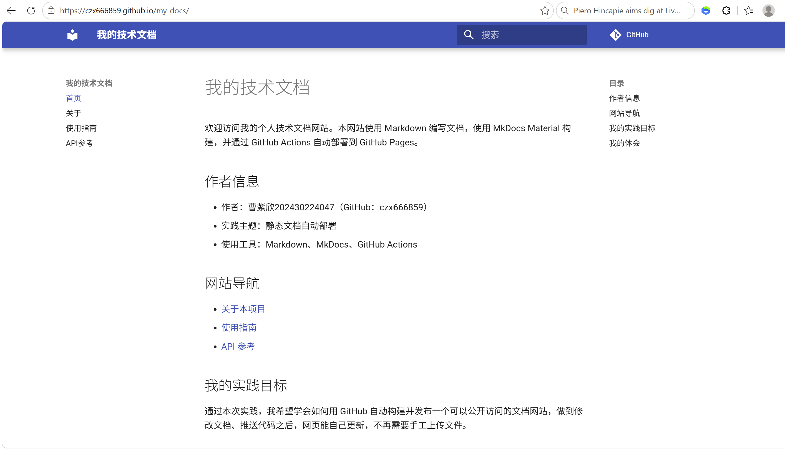
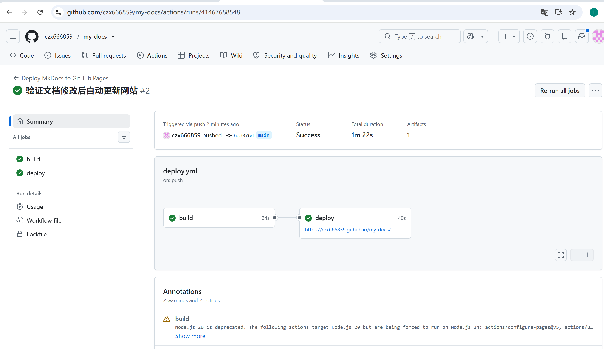
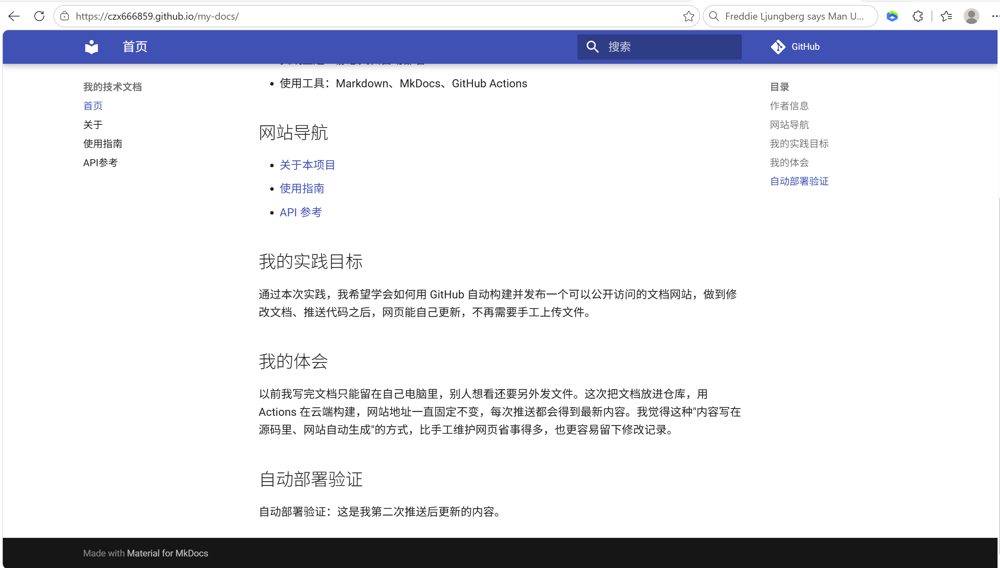

# 实践项目2：个人实验报告

## 1. 基本信息

- GitHub 登录名：czx666859
- 姓名及学号：曹紫欣，202430224047
- 个人仓库地址：https://github.com/czx666859/my-docs
- 最终网站地址：https://czx666859.github.io/my-docs/

## 2. 实践过程与关键截图

### 2.1 环境准备与仓库创建

**环境检查。** 动手之前，我在终端执行了 `git --version`、`python --version` 和 `python -m pip --version`，确认工具可用。截图显示 Git 2.55.0.windows.5、Python 3.14.2、pip 25.3。作业推荐 Python 3.12；我本地使用 Python 3.14.2，因此本地构建后又通过工作流使用 Python 3.12 完成云端构建。

**创建仓库。** 我在自己的 GitHub 账号下创建了公开仓库 `my-docs`。仓库页面显示所有者为 `czx666859`、仓库名为 `my-docs`、可见性为 Public，默认分支为 `main`。使用公开仓库是为了让教师能够查看源码和访问 GitHub Pages 网站。

**克隆到本地。** 我使用 HTTPS 地址克隆仓库到 `E:\git2\my-docs`，随后执行 `git branch --show-current`，确认当前分支为 `main`，与工作流监听的分支一致。

### 2.2 项目结构与 MkDocs 配置

我按要求创建了 `docs/` 下的四个页面（`index.md`、`about.md`、`guide.md`、`api.md`），以及 `mkdocs.yml`、`requirements.txt`、`.gitignore` 和 `.github/workflows/deploy.yml`。实验报告和过程截图放在 `report/`。

- `docs/` 存放网站的 Markdown 源文件，是我编写和维护的内容。
- `mkdocs.yml` 配置站点名称、网站地址、主题和导航。`nav` 中的路径相对于 `docs/`，所以写 `index.md`，不写 `docs/index.md`。
- `site/` 是 MkDocs 构建生成的静态网站文件，构建时自动生成，不需要手工修改或提交。
- `.github/workflows/deploy.yml` 定义 Actions 如何安装依赖、构建网站并发布到 GitHub Pages。
- `report/` 保存个人实验报告和关键步骤截图。

截图展示了项目根目录中的主要文件和文件夹：`.github/workflows/deploy.yml` 是自动部署工作流，`docs/` 中有 `index.md`、`about.md`、`guide.md` 和 `api.md` 四个网站页面，`report/` 中保存实验报告和截图；根目录还包含 `.gitignore`、`mkdocs.yml`、`README.md` 和 `requirements.txt`。左侧同时能看到本地虚拟环境 `.venv/` 和构建目录 `site/`。

右侧打开的是 `mkdocs.yml`：其中 `site_name` 设置网站名称，`site_url` 和 `repo_url` 分别指向部署后的网站和源码仓库；`theme` 使用 Material 并设置中文，`nav` 定义四个页面的导航名称和顺序。导航路径相对于 `docs/`，因此配置中写 `index.md`、`about.md` 等文件名，不写 `docs/index.md`。`docs/` 保存我编写的 Markdown 源文件，`site/` 是 MkDocs 构建生成的网站文件；工作流会构建并部署 `site/`，所以日常修改应放在 `docs/` 中。`.github/workflows/deploy.yml` 负责自动构建和发布，`report/` 则用于记录作业过程与结果。

### 2.3 本地构建与预览

我在项目目录创建并激活 Python 虚拟环境，再安装 `requirements.txt` 中的依赖，执行 `python -m mkdocs build --strict`。截图显示文档在 4.94 秒内构建成功。终端还显示 pip 更新提示和 Material for MkDocs 的维护公告；它们没有导致本次构建失败。

接着运行 `python -m mkdocs serve` 做本地预览。由于 `mkdocs.yml` 配置了 `site_url`，本地访问地址为 `http://127.0.0.1:8000/my-docs/`。我通过左侧导航检查首页、关于、使用指南和 API 参考四页，并检查了页面链接、表格和代码示例。

### 2.4 GitHub Pages 设置

我在仓库的 `Settings → Pages → Build and deployment` 中将 `Source` 设为 `GitHub Actions`，页面提示设置已保存。使用这个发布来源后，工作流会上传构建产物并部署，不需要创建 `gh-pages` 分支。我也确认仓库允许运行 Actions。

### 2.5 Actions 首次构建和部署

第一次工作流运行由我向 `main` 分支推送项目文件触发。运行记录为 **Deploy MkDocs to GitHub Pages #1**，具体结果如下：

- **触发方式：** `push`，运行页面显示提交者为 `czx666859`，分支为 `main`，对应提交短哈希为 `75f6044`。
- **整体结果：** 状态为 **Success**，总耗时 **57 秒**，并生成了 1 个部署 artifact。
- **`build` 任务：** 成功，耗时 **27 秒**。工作流完成源码检出、Python 环境配置、依赖安装和 MkDocs 构建，并上传生成的网站文件。
- **`deploy` 任务：** 在 `build` 成功后运行，状态为成功，耗时 **22 秒**，将构建产物发布到 GitHub Pages。
- **发布地址：** 运行记录显示网站地址为 <https://czx666859.github.io/my-docs/>。
- **运行提示：** 页面显示 Node.js 20 弃用相关提示，但两个任务均成功，提示没有阻止本次构建和部署。

运行链接：[第一次 Actions 运行](https://github.com/czx666859/my-docs/actions/runs/41465673242)

### 2.6 网站访问与四页导航检查

我打开部署记录提供的 GitHub Pages 地址，确认网站能够访问，浏览器地址栏显示 `https://czx666859.github.io/my-docs/`。我逐页检查了首页、关于、使用指南和 API 参考，并确认导航和站内链接可用。截图展示了部署后的网站首页。

### 2.7 第二次推送与自动更新验证

为了验证后续修改能够自动发布，我在 `docs/index.md` 中增加了这句话：

> 自动部署验证：这是我第二次推送后更新的内容。

提交并推送后，Actions 记录 **Deploy MkDocs to GitHub Pages #2** 显示由 `push` 触发，`build` 和 `deploy` 均成功，总耗时 1 分 22 秒。随后我刷新网站，确认首页出现了新增文字。第二次运行对应的提交短哈希为 `bad376d`。

- 对应提交：[bad376d](https://github.com/czx666859/my-docs/commit/bad376d)
- 对应 Actions 运行：[第二次自动部署运行](https://github.com/czx666859/my-docs/actions/runs/41467688548)

## 3. 问题与解决

- **本地预览地址带有 `/my-docs/`：** 我最初以为预览地址会是 `http://127.0.0.1:8000/`。检查后发现配置文件中的 `site_url` 包含项目仓库路径，因此本地预览地址为 `http://127.0.0.1:8000/my-docs/`。使用这个地址后，页面正常打开。
- **构建时出现提示信息：** 本地构建输出了 pip 更新提示和 Material for MkDocs 的维护公告，但最终显示文档构建成功。首次和第二次 Actions 运行也都显示成功；运行页面另显示 Node.js 20 弃用提示。本次这些提示没有阻止构建或部署。
- **本地和云端 Python 版本不同：** 本地环境为 Python 3.14.2，工作流配置 Python 3.12。本地严格构建成功，云端工作流的 `build` 任务也成功。
- **部署排错检查：** 两次运行页面中的 `build` 和 `deploy` 均为成功状态，因此没有需要修复的失败步骤。我核对了触发方式、分支 `main`、任务状态和部署地址。

## 4. 原理理解

1. **`docs/` 和 `site/` 各保存什么？为什么不用手工修改 `site/`？** `docs/` 保存我编写的 Markdown 源文件，例如首页、关于、使用指南和 API 参考。MkDocs 根据这些源文件和 `mkdocs.yml` 的配置生成 `site/`，其中包含浏览器访问所需的 HTML、样式和其他静态资源。`site/` 是构建产物，每次构建都会重新生成；如果直接修改里面的文件，改动可能在下一次构建时被覆盖，也无法反映回源文档。因此我应修改 `docs/` 中的 Markdown，再重新构建和部署。

2. **本次工作流在什么情况下自动运行？** 工作流监听 `main` 分支上的 `push`，并设置了文件路径过滤条件：推送中包含 `docs/**`、`mkdocs.yml`、`requirements.txt` 或 `.github/workflows/deploy.yml` 的改动时会自动运行。比如修改网站页面后推送到 `main`，就会触发构建和部署；只修改不在这些路径里的文件则不会触发。工作流还配置了 `workflow_dispatch`，所以也可以在仓库的 Actions 页面手动启动，适合手动重试或排查问题。

3. **`build` 与 `deploy` 两个任务有什么区别？** `build` 负责准备和生成网站：检出仓库源码、配置 Python 3.12、安装 `requirements.txt` 中的依赖、运行 `python -m mkdocs build --strict`，最后将 `site/` 上传为 GitHub Pages artifact。`deploy` 通过 `needs: build` 依赖构建任务，只有构建成功后才会运行；它使用 Pages 部署权限和 OIDC 身份令牌，把刚才上传的 artifact 发布到 GitHub Pages。这样可以从运行记录中分别确认构建和发布是否成功。

4. **只修改 `report/README.md` 会触发部署吗？为什么？** 不会。工作流的 `push.paths` 只包含网站源文件、MkDocs 配置、依赖文件和工作流本身，没有包含 `report/README.md` 或 `report/images/**`。因此只更新报告或截图时，GitHub 不会启动这条网站部署工作流。报告是作业材料，不属于 MkDocs 网站构建所需的输入；如果同一次推送也修改了 `docs/` 等被监听的文件，工作流才会触发。

5. **本次方案为何无需创建 `gh-pages` 分支？** 传统分支发布方式会把构建后的静态文件推送到专门的发布分支。本次在仓库 Pages 设置中选择 `GitHub Actions` 作为发布来源，工作流先把 `site/` 上传为 Pages artifact，再由 `actions/deploy-pages` 直接发布这个 artifact。GitHub Pages 通过工作流和部署环境接收构建产物，所以源码只需保留在 `main`，不需要额外创建或维护 `gh-pages` 分支。
